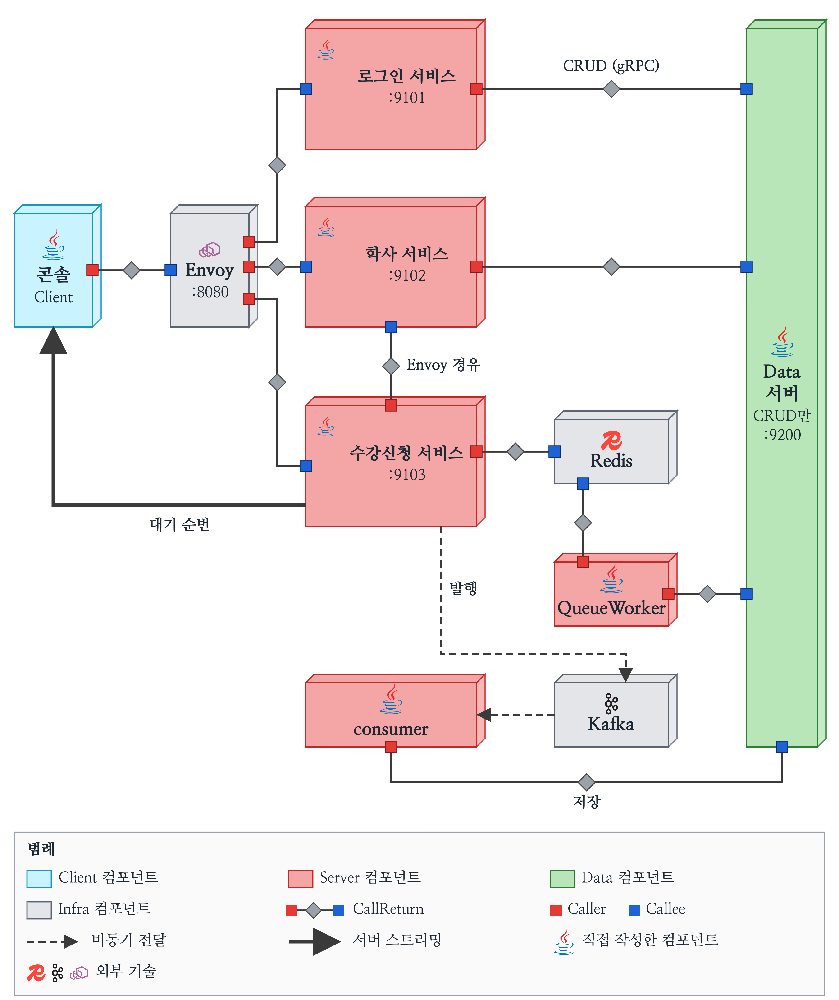
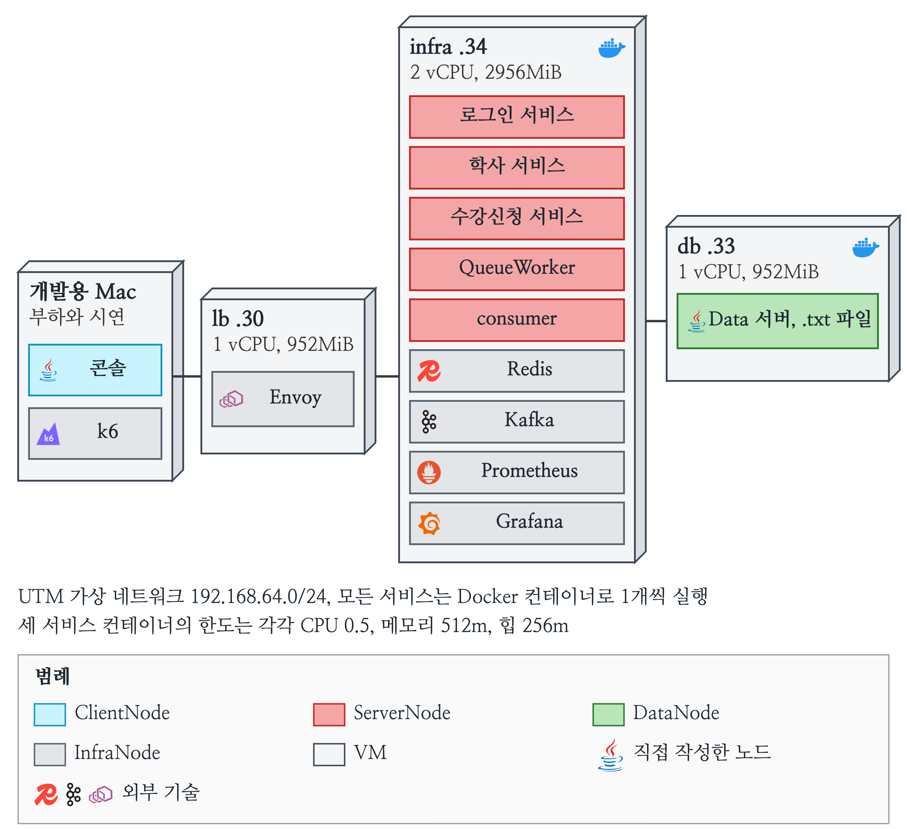
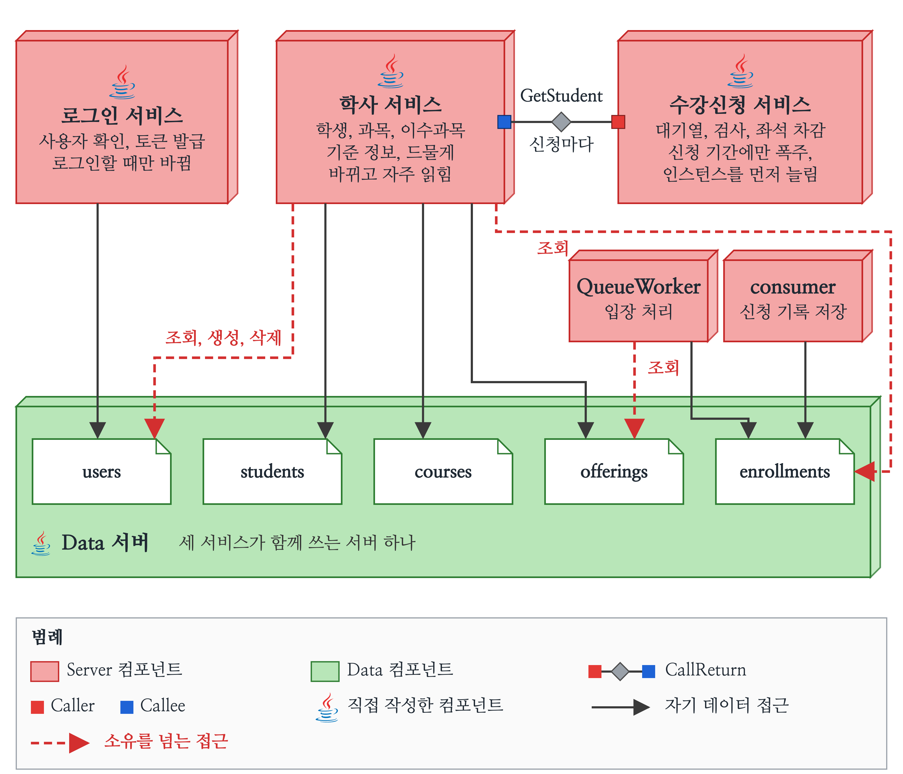
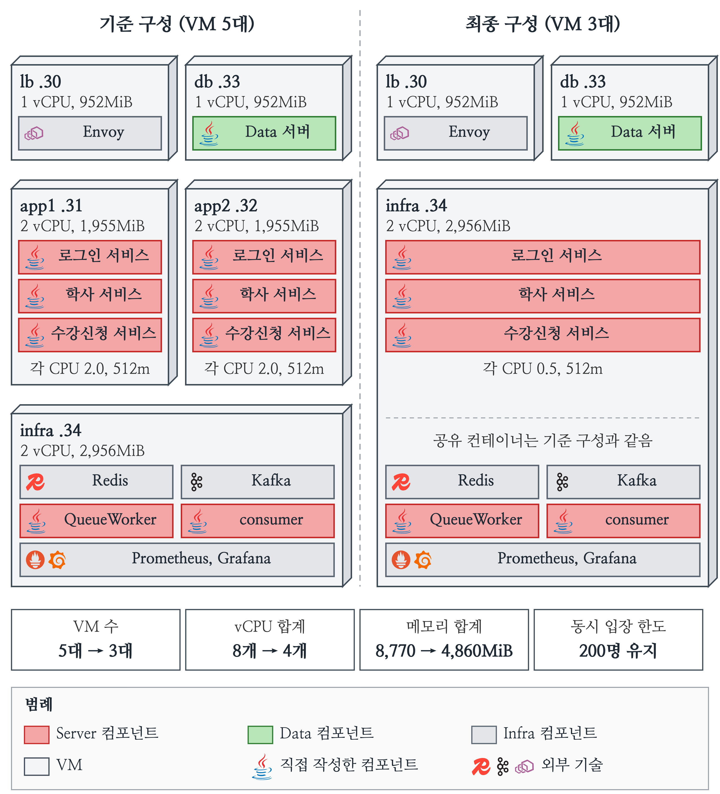
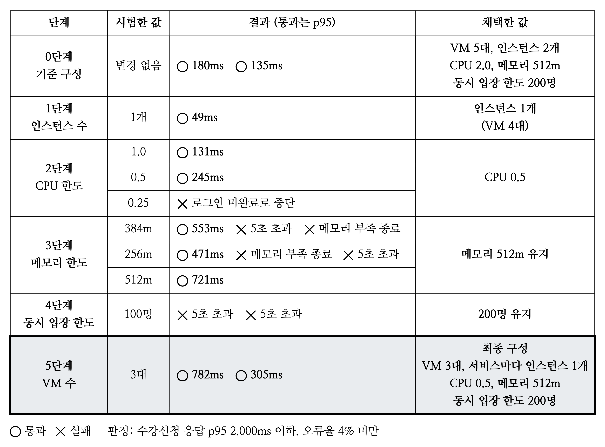

# 수강신청 서버 아키텍처

정각에 수천 명이 몰리는 수강신청을 Java gRPC 기반 MSA로 설계하고 구현한 프로젝트입니다. Envoy가 요청을 세 서비스로 나누고 Redis 대기열이 입장 인원을 조절하며, 신청 기록은 Kafka를 거쳐 Data 서버에 저장됩니다.

## 전체 아키텍처



콘솔 Client는 Envoy를 거쳐 로그인, 학사, 수강신청 서비스를 호출하고 데이터는 모두 Data 서버의 CRUD로만 다룹니다.



최종 구성은 VM 3대이며 서비스마다 인스턴스를 하나씩 둡니다.

| VM | 올라가는 것 |
| --- | --- |
| lb .30 | Envoy |
| db .33 | Data 서버 |
| infra .34 | 세 서비스, QueueWorker, consumer, Redis, Kafka, Prometheus, Grafana |

## 서비스 분리



서비스는 바뀌는 이유와 부하가 몰리는 시점에 따라 나눴습니다. Data 서버의 데이터 종류 이름마다 소유 서비스를 정했고 소유를 넘는 접근은 점선으로 표시했습니다.

## 결과



학생 3,660명 부하에서 자원을 단계별로 줄여 본 결과, 최종 구성은 두 번 모두 오류 없이 통과했고 수강신청 응답 p95는 782ms와 305ms였습니다.

| 항목 | 기준 구성 | 최종 구성 |
| --- | --- | --- |
| VM 수 | 5대 | 3대 |
| vCPU 합계 | 8개 | 4개 |
| 메모리 합계 | 8,770MiB | 4,860MiB |
| 앱 컨테이너 CPU 한도 합계 | 12.0 | 1.5 |
| 동시 입장 한도 | 200명 | 200명 |



## 실행 방법

Docker만 있으면 되고 자세한 설명은 [실행방법.md](실행방법.md)에 있습니다.

```bash
docker compose run --rm client
docker compose down
```

테스트 계정의 비밀번호는 아이디와 같습니다.

| 역할 | 아이디 |
| --- | --- |
| 학생 | 60220435 |
| 교수 | P001 ~ P005 |

## 디렉터리

| 폴더 | 내용 |
| --- | --- |
| Proto | gRPC 계약 |
| Server | 로그인, 학사, 수강신청 서비스와 QueueWorker, consumer |
| Data | Data 서버 |
| Client | 콘솔 Client |
| Common | 공통 코드 |
| deploy | compose 파일, Envoy 이미지, VM 배포 스크립트 |
