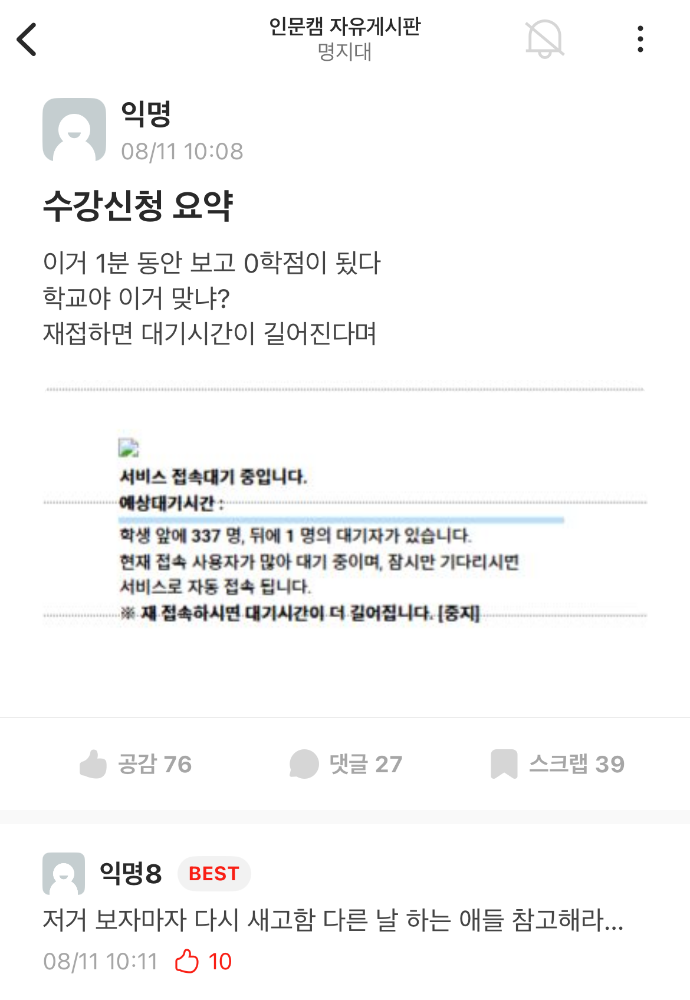
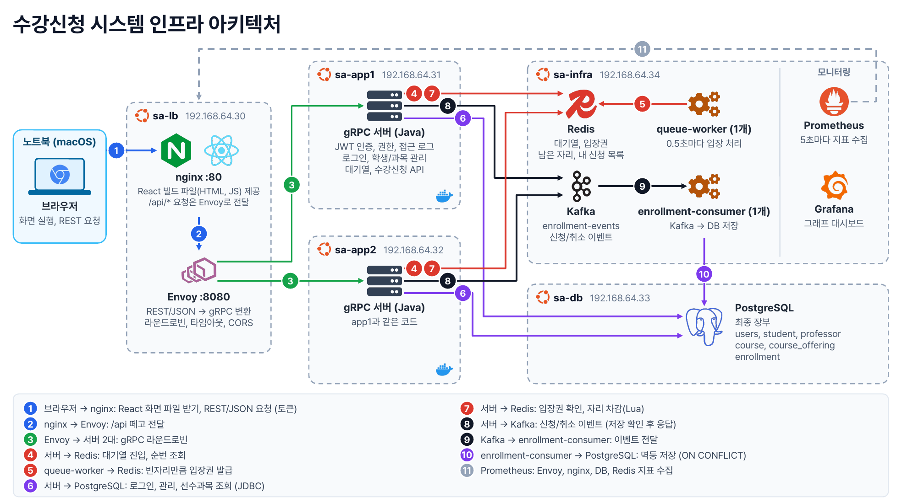

# 수강신청 서버 아키텍처

## 문제 정의

수강신청은 정해진 시각에 수천 명이 동시에 같은 버튼을 누르는 서비스입니다. 기준으로 삼은 것은 명지대 2026년 8월 11일 수강신청으로, 대상은 인문대학, 사회과학대학, 인공지능소프트웨어융합대학 학생 3,660명이었고 이날 신청 페이지 진입 시점에 장애가 있었습니다.

당일 대기열 안내는 재접속하면 더 기다린다고 했지만, 실제로는 기다린 학생은 계속 접속하지 못하고 새로고침한 학생이 먼저 들어갔습니다. 이 상황에서 풀어야 할 문제는 세 가지입니다.

1. 서버와 DB 과부하: 3,660명이 1~3초 안에 몰리고, 학생 한 명이 약 6과목을 신청해 약 22,000건의 신청이 짧은 시간에 들어옵니다.
2. 정원 초과: 인기 분반 하나에 신청이 몰릴 때 서버 여러 대가 동시에 자리를 차감해도 정원을 넘기면 안 됩니다.
3. 공정성: 기다린 순서대로 들어가야 하고, 새로고침이 이득이 되거나 멈춘 요청에 갇히면 안 됩니다.

## 문제 해결 과정

### 출발점

목표는 단순했습니다. 위의 8/11 상황, 즉 3,660명이 같은 순간에 몰려도 서버가 버티고, 정원이 넘치지 않고, 기다린 순서대로 들어가는 아키텍처를 직접 설계해 보는 것이었습니다.

먼저 8/11에 무엇이 터졌는지부터 나눠 생각했습니다. 정각의 진입은 모두가 같은 순간 같은 무거운 일을 하는 요청량 문제이고, 진입 뒤 과목별 신청은 인기 분반 하나의 정원에 동시 쓰기가 몰리는 경합 문제입니다. 성격이 다르니 따로 풀기로 했습니다.

### 1단계: 먼저 정원이 깨지지 않게

가장 먼저 지켜야 할 것은 정원 초과가 없어야 한다는 점이었습니다. 처음 떠오른 방법은 DB에서 행 잠금으로 정원을 확인하고 줄이는 것이었습니다. 하지만 인기 분반 하나에 수백 명이 몰리면 잠금을 기다리는 요청이 DB 연결을 오래 붙잡고, 그 지연이 다른 요청까지 번질 수 있습니다.

그래서 정원 판단을 Redis로 옮겼습니다. 중복 신청 확인, 남은 자리 확인, 차감을 Lua 스크립트 하나로 묶으면 Redis가 스크립트를 하나씩 실행하므로 서버가 여러 대여도 한 자리가 두 번 팔리지 않습니다. 선수과목, 시간 충돌, 같은 과목 다른 분반, 학점 한도처럼 그 학생에게만 해당하는 검사는 차감 전에 미리 끝냅니다.

검증은 가장 나쁜 경우로 했습니다. 정원 5명인 분반에 학생 17명이 동시에 출발하도록 맞춰 신청하게 했고, 서버 두 대가 8건, 9건씩 나눠 받았는데 성공은 정확히 5건, DB 기록도 5건이었습니다.

### 2단계: 몰리는 사람을 줄 세우기

정원이 지켜져도 3,660명이 한꺼번에 들어오면 서버가 먼저 무너집니다. 그래서 대기열을 두고, 서버가 감당할 수 있는 인원만 들여보내기로 했습니다.

줄을 세우는 키를 정할 때 많은 서비스가 쓰는 익명 번호표와 비교했습니다. 번호표는 새로고침하면 잃어버려 맨 뒤로 밀립니다. 8/11에 새로고침한 사람이 오히려 먼저 들어갔던 것과도 맞지 않습니다. 이 시스템은 로그인한 학번을 키로 Redis Sorted Set에 넣고 이미 있으면 덮어쓰지 않게(`ZADD NX`) 해서, 새로고침해도 순번이 그대로이고 한 학생이 두 번 줄을 설 수 없게 했습니다. 대가는 로그인이 대기열의 보호를 받지 못한다는 점이라, 미리 로그인해 두는 것을 전제로 했습니다.

입장 방식은 운영자가 정한 동시 입장 한도 안에서 빈자리만큼만 들여보내는 방식으로 했습니다. 입장 처리를 각 서버 안에 두면 서버 두 대가 각자 세서 한도가 두 배가 됩니다. 그래서 sa-infra에 QueueWorker 하나를 따로 두고, 0.5초마다 "한도 - 현재 입장 인원"만큼만 입장권을 발급하게 했습니다. 8/11에 줄이 멈췄던 원인 중 하나로 자리 미반납을 추정했기 때문에, 입장권에는 유효 시간을 두고 신청을 마치면 반납하게 했습니다. 한도 3명, 10명 동시 대기로 시험했을 때 순번이 10, 7, 4, 1, 입장 순으로 줄었습니다.

### 3단계: DB가 순간 폭주를 직접 받지 않게

정원은 Redis에서 정해지지만 신청 기록은 결국 DB에 남아야 합니다. 처음에는 Kafka가 꼭 필요한지 따져 봤습니다. 8/11 기준 약 22,000건을 1분 안팎에 저장하면 초당 수백 건이라 PostgreSQL 한 대로도 계산상 충분했습니다. 그래도 DB를 쉽게 키울 수 없는 상황을 전제로, 순간 폭주를 흡수하고 DB가 잠시 멈춰도 기록을 잃지 않도록 서버와 DB 사이에 Kafka를 넣었습니다.

넣고 나니 "성공이라고 알렸는데 저장이 실패하면?"이라는 질문이 생겼습니다. 그래서 Kafka가 저장을 확인(`acks=all`)한 뒤에만 성공을 응답하고, Kafka 기록이 실패하면 차감한 자리를 되돌리게 했습니다. enrollment-consumer는 DB 저장이 끝난 뒤에만 읽은 위치를 확정하고, 다시 읽은 메시지는 `ON CONFLICT`로 무시합니다.

### 4단계: 서버를 늘려도 되게

한 대로는 폭주를 받을 수 없으니 서버를 두 대로 늘렸고, 그러자 "어느 서버가 받아도 같은 결과가 나와야 한다"가 조건이 됐습니다. 로그인 상태를 서버 메모리의 세션에 두면 서버끼리 세션을 공유하거나 한 서버에 고정해야 합니다. 그래서 로그인 성공 시 JWT를 발급하고 두 서버가 같은 비밀키로 검증하게 했습니다. app1이 발급한 토큰이 app2에서 그대로 통과했고, app2를 멈춰도 사용자 오류가 없었습니다.

앞단은 Envoy가 맡았습니다. 브라우저는 gRPC를 직접 쓸 수 없어 처음에는 gRPC-Web을 썼지만, 밖은 REST, 안은 gRPC가 더 일반적인 구조라 Envoy의 gRPC-JSON transcoder로 바꿨습니다. Java 서버 코드는 바꾸지 않았습니다. Envoy는 두 서버에 라운드로빈으로 나누고, 8/11에 멈춘 요청이 끝없이 기다렸던 것을 막으려고 요청마다 5초 제한 시간과 응답 없는 서버를 빼는 outlier detection을 걸었습니다.

인증 검사와 과제가 요구한 접근 로그는 모든 요청에 똑같이 붙어야 해서 서비스 코드마다 넣지 않고 gRPC interceptor로 뺐습니다. `AuthInterceptor`가 토큰과 역할을 검사하고, `AccessLogInterceptor`가 거절과 실패까지 포함해 사용자 ID, 명령, 결과, 시각을 서버별 파일에 한 줄씩 남깁니다.

### 5단계: 실제로 부하를 걸어 보니

설계만으로는 버틴다고 말할 수 없어서 k6로 3,660명을 재현했습니다(A: 대기열 없음, B: 동시 입장 한도 500). 서버 상태는 Prometheus와 Grafana로, VM CPU는 각 VM의 `vmstat`으로 봤습니다.

기준선 A에서 가장 먼저 무너진 것은 sa-db였습니다. CPU 평균 98%였고, 이유를 찾아보니 수강신청과 강의 목록이 요청마다 학기 분반 308개를 DB에서 다시 읽고 있었습니다. 앱 서버는 CPU 40% 정도로 여유가 있는데도 DB 연결 10개, Redis 연결 8개를 기다리느라 느렸습니다. 요청이 쌓이자 Envoy의 동시 요청 기본 상한 1,024에 걸려 약 7,055건이 503으로 거절됐습니다. 8/11에 학생들이 본 "접속 오류"와 같은 모습이었습니다. 그래도 정원 초과는 0건이었습니다. 무너진 것은 정합성이 아니라 응답 시간이었습니다.

대기열을 켠 B는 오류율을 16.28%에서 5.01%로 낮췄지만 DB는 여전히 평균 91%였습니다. 그래서 개설 강의 목록을 서버 메모리에 두고 60초마다 갱신하게 하고(`OfferingCatalog`), 남은 좌석은 Redis에서 읽고, 연결 풀을 Redis 128개, DB 30개로 늘렸습니다. sa-db CPU는 평균 25%로, 수강신청 p95는 11.7초에서 2.0초로 내려갔습니다.

DB가 풀리자 병목이 대기열 조회로 옮겨 갔습니다. 3,000명 넘는 대기자가 2초마다 순번을 물어 조회 p95가 60초 제한에 걸렸습니다. 학생 수를 1,830명으로 줄여 다시 보니 이번에는 대기열 조회가 다시 Envoy 상한 1,024에 걸려 HTTP 실패율 15.15%, 중도 포기 239명이 났습니다. 상한을 10,000으로 올리자 실패율 0.00%, 중도 포기 0명이 됐습니다. 남은 것은 조회 p99 36.5초였고, 조회 간격을 2초에서 5초로 늘려 5.9초로 줄였습니다. 대신 입장을 알아채는 데 최대 5초가 더 걸리는 것은 받아들였습니다.

| 순서 | 병목 | 조치 | 결과 |
| --- | --- | --- | --- |
| 1 | sa-db CPU 평균 91~98%, 요청마다 분반 308개 재조회 | 강의 목록 메모리 캐시, 좌석은 Redis, 풀 확대 | sa-db 25%, 수강신청 p95 11.7초에서 2.0초 |
| 2 | Envoy 동시 요청 상한 1,024 | 상한 10,000 | HTTP 실패율 15.15%에서 0.00% |
| 3 | 대기자의 2초 간격 조회 | 조회 간격 5초 | 조회 p99 36.5초에서 5.9초 |

### 6단계: 규칙 위반을 사용자에게 정확히 알리기

마지막으로 사용자가 보는 메시지를 다듬었습니다. 시간이 겹치는 강의를 신청하면 서버가 `CustomException`을 던지고, 이를 gRPC Status로 바꿔 "신청한 강의(...)와 시간이 겹쳐 수강신청할 수 없습니다."를 그대로 돌려줍니다. 웹 화면은 이 메시지를 알림창에 띄웁니다.

상태 코드는 `ABORTED`로 했습니다. 이 서버에서 `FAILED_PRECONDITION`은 입장권 만료와 오픈 전 진입에 쓰고, 웹 클라이언트는 이 코드를 받으면 입장권이 끝난 것으로 보고 대기열로 돌려보냅니다. 시간 충돌에 같은 코드를 쓰면 규칙 위반 하나로 학생이 줄 밖으로 밀려나므로 다른 코드를 골랐습니다.

## 결과

| 항목 | 결과 |
| --- | --- |
| 동시 신청: 정원 5명 분반에 17명 동시 신청 | 성공 5, 정원 마감 12, 오류 0, 전체 367ms. 서버 분배 app1 8건, app2 9건. Redis 남은 자리 0, DB 신청 행 5건 |
| 1,830명 B (`B-1015-053649`) | 신청 10,980건 중 성공 7,311, 정원 마감 3,669, 오류 0. HTTP 실패율 0.00%, 중도 포기 0명 |
| 1,830명 B 정합성 | DB 신청 행 7,311 = 성공 7,311, 정원 초과 분반 0개, Redis 좌석 불일치 0개, 마지막 성공 후 1.5초 안에 Kafka 반영 끝 |
| 1,830명 B 시간 | 마지막 학생 입장 오픈 55.3초, 마지막 신청 성공 오픈 59.1초, 수강신청 p95 2.1초 |
| 발표자 입장 (1,830명 중, 오픈 0.45초 뒤 클릭) | 첫 순번 104, 조회 1번, 시간 초과 0번, 화면에 입장 표시 오픈 6.6초 |
| 3,660명 B 수강신청 p95 | 개선 전 11.7초, 개선 후 2.0초 |
| 3,660명 B sa-db CPU 평균 / 최고 | 개선 전 91% / 100%, 개선 후 25% / 91% |
| 3,660명 B 입장 후 머문 시간 중앙값 | 개선 전 36.8초, 개선 후 5.7초 |
| 정원 초과 | 모든 실행(A, B, 리허설 150, 300, 700명 포함)에서 0건 |

측정 기록은 [demo/results/BASELINE.md](demo/results/BASELINE.md), [demo/results/TUNING.md](demo/results/TUNING.md), [demo/results/RESULTS.md](demo/results/RESULTS.md)에 있습니다.

## 의의

- 정합성과 처리량을 나눠서 풀었습니다. 정원은 Redis Lua 한 곳에서만 결정하므로, 응답이 60초씩 밀리던 과부하 상황에서도 정원 초과와 Redis, DB 불일치가 한 번도 나지 않았습니다.
- 8/11 장애의 모습(서버는 살아 있는데 요청이 503이나 시간 초과로 끝남)을 Envoy 서킷 브레이커와 대기열 조회 폭주로 실제로 재현하고, 원인을 수치로 확인했습니다.
- 추측이 아니라 측정으로 병목을 옮겨 가며 고쳤습니다. DB, 커넥션 풀, Envoy 상한, 대기열 조회 순으로 병목이 바뀌는 것을 CPU와 응답 시간으로 확인했습니다.
- 학번 기반 대기열로 새로고침해도 순번이 유지되고, 입장권 유효 시간과 반납으로 자리가 묶여 줄이 멈추는 문제를 막았습니다.

## 한계

- 3,660명 전체 B는 개선 후에도 약 5분 걸리고 신청 오류율 4.00%가 남았습니다. 0 오류를 확인한 것은 1,830명입니다. 같은 1,830명을 나중에 다시 돌린 실행(`B-1015-112537`)에서는 오류 23건(0.21%), 수강신청 p95 8.9초로 결과가 흔들렸습니다.
- k6에 정한 응답 시간 목표(수강신청 p95 1초, 대기열 조회 p95 0.5초 등)는 모든 실행에서 넘지 못했습니다.
- 개설 강의 캐시는 서버마다 60초마다 갱신합니다. 한 서버에서 과목을 추가하거나 지우면 다른 서버는 최대 60초 동안 이전 목록을 볼 수 있습니다.
- 대기열 조회 간격이 5초라 입장 처리 뒤 화면에 입장이 뜨기까지 최대 5초가 더 걸립니다.
- 앱 VM은 2 vCPU, sa-lb와 sa-db는 1 vCPU입니다. 개선 후에도 앱 VM과 sa-lb CPU 최고값이 99~100%에 닿았습니다.
- 앱 서버 JVM 지표와 VM 노드 지표는 Prometheus에 없어 `vmstat`으로 따로 쟀고, Envoy의 서버별(endpoint) 통계도 켜지 않았습니다.
- Redis, Kafka, PostgreSQL이 각각 한 대뿐이라 단일 장애 지점이고, Kafka 복제로 유실을 막는 보장도 없습니다. 서버가 자리를 차감한 직후 Kafka 기록 전에 죽으면 자리만 줄어드는데, 이를 맞추는 Redis, DB 대조 작업은 만들지 않았습니다.
- JWT는 라이브러리 없이 `javax.crypto`로 직접 구현해 검증된 라이브러리만큼 검토되지 않았습니다.
- 로그인(bcrypt)은 두 서버 합쳐 초당 약 18명이 한계라, 재현 시나리오는 미리 로그인한 토큰으로 시작합니다.
- VM 다섯 대와 부하 생성기(k6)가 모두 맥 한 대 위에서 돌아 서로 CPU를 나눠 씁니다. 실제 서비스 규모의 수치로 그대로 옮길 수는 없습니다.
- 학점 한도 초과와 DLT 경로는 시드 데이터로 재현할 조합이 없어 직접 확인하지 못했습니다.
