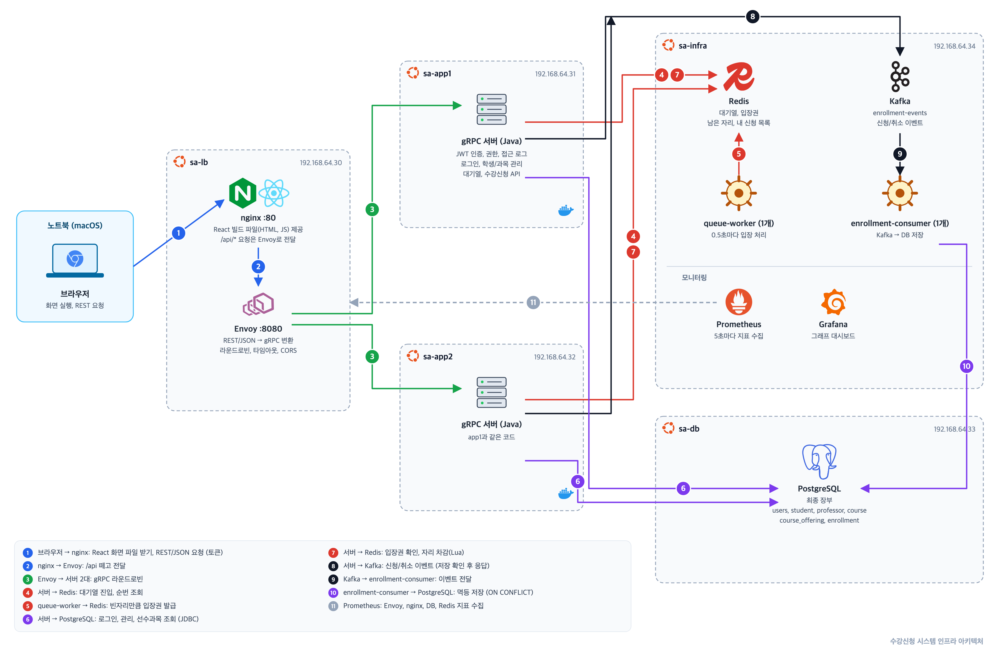
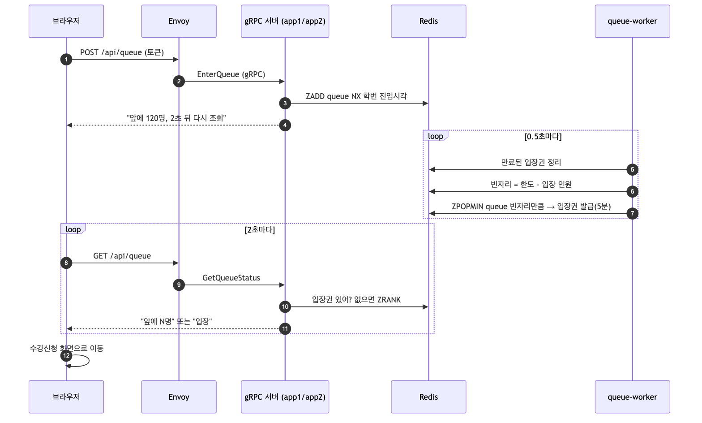
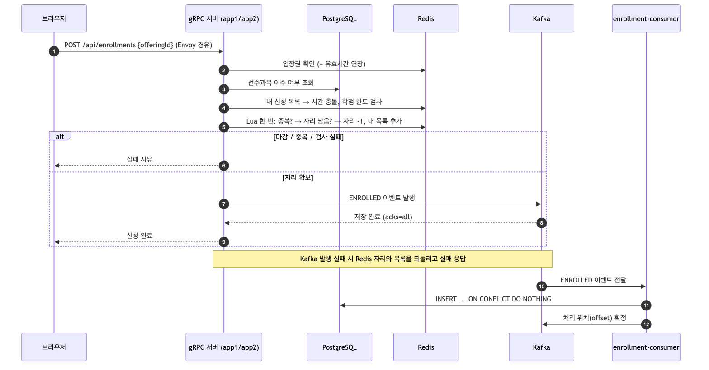

# 수강신청 시스템

### gRPC 3계층 수강신청 서버 – 서버아키텍처설계 과제

**정원 5명 강의에 17명이 동시에 눌러도, 정확히 5명만.**

  
  


## ✅ 과제 요구사항을 모두 구현했습니다

| 요구사항 | 구현 |
| --- | --- |
| 학생 목록, 과목 목록 | 교수 계정으로 조회 |
| 학생 추가/삭제, 과목 추가/삭제 | 교수 계정으로 관리 화면에서 처리 |
| 수강신청 | 학생 계정으로 대기열을 거쳐 신청과 취소 |
| 사용자 인증 | 로그인 ID와 비밀번호로 인증, 토큰(JWT) 발급 |
| 로그 | 모든 요청을 사용자 ID, 명령, 시각과 함께 텍스트 파일에 한 줄씩 기록 |

과제 요구사항 외에 다음을 추가로 구현했습니다.

- **추가 구현 1**: gRPC를 이용한 클라이언트-서버-데이터 3계층 아키텍처
- **추가 구현 2**: 클라이언트 화면을 보기 좋게 만들고, 예외 처리와 리팩토링으로 화면 컴포넌트 분리
- **추가 구현 3**: Proto 모듈을 분리해 계층 사이의 gRPC 통신 규약 공유

## ⚡ 동시 신청 17건, 성공 5건, 오류 0건, 367ms

정원이 5명인 분반(17653-02)에 학생 17명이 같은 순간에 신청 버튼을 누르는 상황을 만들었습니다. 서버 두 대가 요청을 나눠 받았지만 정원을 넘긴 신청은 한 건도 없었습니다.

| 항목 | 결과 |
| --- | --- |
| 신청 성공 | **5건** |
| "정원이 마감되었습니다." | 12건 |
| 오류 | 0건 |
| 전체 처리 시간 | 367ms |
| 요청 분배 | app1 8건 (성공 2), app2 9건 (성공 3) |
| Redis 남은 자리 / DB 신청 기록 | 0 / 정확히 5건 |


&nbsp;

&nbsp;

## 목차

- 🧭 [**구성**](#구성)
- 🚀 [**실행 방법**](#실행-방법)
  - [테스트 계정](#테스트-계정)
  - [접근 로그](#접근-로그)
- 🛠 [**개발 기록**](#개발-기록)
- 📂 [**문서**](#문서)

---

# 구성

## 서버 다섯 대

맥북 한 대 위에 UTM으로 Ubuntu 가상 머신 다섯 대를 띄우고, 역할별로 나눠 올렸습니다. 모든 구성 요소는 Docker 컨테이너로 실행합니다.

| VM | IP | 역할 |
| --- | --- | --- |
| **sa-lb** | 192.168.64.30 | nginx (웹 화면 제공), Envoy (REST를 gRPC로 변환, 서버 두 대에 나눠 보내기) |
| **sa-app1** | 192.168.64.31 | Java gRPC 서버 |
| **sa-app2** | 192.168.64.32 | Java gRPC 서버 (app1과 같은 코드) |
| **sa-db** | 192.168.64.33 | PostgreSQL |
| **sa-infra** | 192.168.64.34 | Redis, Kafka, queue-worker, enrollment-consumer, Prometheus, Grafana |

## 요청이 지나가는 길

1. 브라우저는 nginx에서 웹 화면을 받고, `/api`로 시작하는 요청을 REST(JSON)로 보냅니다.
2. nginx는 `/api`를 떼고 Envoy로 넘깁니다.
3. Envoy는 JSON을 gRPC로 바꿔 서버 두 대에 번갈아 보냅니다. 한 대가 응답하지 않으면 나머지 한 대로만 보냅니다.
4. 서버는 대기열, 입장권, 남은 자리를 Redis에서 처리합니다.
5. 신청과 취소는 Kafka에 이벤트로 남긴 뒤 응답합니다.
6. 로그인과 학생/과목 관리는 서버가 PostgreSQL을 직접 조회합니다.
7. queue-worker는 0.5초마다 빈자리만큼 대기열의 학생을 입장시킵니다.
8. enrollment-consumer는 Kafka의 이벤트를 받아 PostgreSQL에 저장합니다.

## 기술 스택

| 구분 | 사용한 것 |
| --- | --- |
| 서버 | Java 21, gRPC, HikariCP, Flyway, bcrypt, JWT |
| 웹 | React, TypeScript, Vite |
| 앞단 | nginx, Envoy (gRPC-JSON transcoder) |
| 데이터 | PostgreSQL 18, Redis 8, Kafka 4 |
| 모니터링 | Prometheus, Grafana |
| 실행 환경 | UTM, Ubuntu 24.04, Docker Compose |

과제가 요구하는 부분(gRPC 서버와 클라이언트)은 직접 구현하고, 로드밸런서, 대기열 저장소, 메시지 큐, 모니터링은 현업에서 쓰는 도구를 그대로 가져다 썼습니다.

&nbsp;

---

# 실행 방법

## 컴퓨터 한 대에서 실행

VM 없이 확인할 때는 저장소 루트의 compose 파일 하나로 전부 올라갑니다. Docker만 있으면 됩니다.

```bash
docker compose up -d --build
```

> 📍 **접속 주소:** **`http://localhost`**

## VM 다섯 대에 배포

각 VM의 `~/sa`에 저장소를 복사한 뒤 역할에 맞는 compose 파일을 실행합니다. 순서는 db, infra, app1과 app2, lb입니다. 로그 폴더 권한과 설정값은 [배포 가이드](deploy/README.md)에 있습니다.

```bash
ssh sa-db    'cd ~/sa && docker compose -f deploy/db/docker-compose.yml up -d'
ssh sa-infra 'cd ~/sa && docker compose -f deploy/infra/docker-compose.yml up -d --build'
ssh sa-app1  'cd ~/sa && SERVER_NAME=$(hostname) docker compose -f deploy/app/docker-compose.yml up -d --build'
ssh sa-app2  'cd ~/sa && SERVER_NAME=$(hostname) docker compose -f deploy/app/docker-compose.yml up -d --build'
ssh sa-lb    'cd ~/sa && docker compose -f deploy/lb/docker-compose.yml up -d --build'
```

> 📍 **접속 주소:** **`http://192.168.64.30`**

DB 테이블과 초기 데이터는 서버가 시작할 때 Flyway가 자동으로 만듭니다. 서버 두 대가 동시에 시작해도 한 대만 적용합니다.

## 테스트 계정

| 구분 | 아이디 | 비밀번호 | 할 수 있는 것 |
| --- | --- | --- | --- |
| 학생 | 학번 (예: `20100123`) | 학번과 같음 | 대기열, 수강신청, 취소 |
| 교수 | `P001` ~ `P005` | 아이디와 같음 | 학생/과목 조회, 추가, 삭제 |

교수 계정은 과목 담당 교수(Park, Kim, Ko, Ahn, Lee)로 만들었습니다. 학생 계정으로 관리 기능을 부르면 403, 토큰 없이 부르면 401이 돌아옵니다.

## 접근 로그

앱 서버마다 `deploy/app/logs/access.log`에 요청이 한 줄씩 쌓입니다. 거절된 요청과 실패한 요청도 남기고, 비밀번호와 토큰은 남기지 않습니다.

```
2026-10-15 02:10:22.296 | server=sa-app1 | user=20100123 | command=LIST_STUDENTS | result=PERMISSION_DENIED | 1ms
```

## 모니터링

| 도구 | 주소 |
| --- | --- |
| Grafana | `http://192.168.64.34:3000` |
| Prometheus | `http://192.168.64.34:9090` |


&nbsp;

---

---

---


&nbsp;

# 개발 기록

## 처음 생각한 문제

이 과제는 txt 파일에 저장된 학생 17명, 과목 7개를 콘솔에서 조회하는 것에서 시작했습니다. 요구사항이 추가/삭제, 수강신청, 인증, 로그로 늘어나면서, 기능만 붙이는 대신 "실제 수강신청 날처럼 사람이 몰려도 버티는 구조"를 목표로 잡았습니다.

기준으로 삼은 것은 명지대 2026년 8월 11일 수강신청입니다. 이날 대상은 인문대학, 사회과학대학, 인공지능소프트웨어융합대학 학생 3,660명이었고, 저도 이날 신청 페이지에 들어가는 순간 시스템이 멈추는 것을 겪었습니다. 그래서 3,660명이 10시 정각 1~3초 안에 한꺼번에 들어오는 상황을 가정했습니다.

## 그날 무슨 일이 있었을까

실제 원인은 공개되지 않았으므로 일반적인 장애 패턴으로 추정했습니다. 처음에는 응답이 느려지자 학생들이 새로고침을 반복해 부하가 몇 배로 늘어났다고 생각했습니다.

그런데 당일 상황을 다시 떠올려 보니 맞지 않는 부분이 있었습니다. 대부분은 새로고침하지 않고 기다렸는데 계속 접속되지 않았고, 오히려 새로고침한 사람은 바로 들어갔습니다. 서버에 여유가 있었는데도 기다리던 요청이 "느린" 것이 아니라 "죽어 있었다"는 뜻입니다. 이렇게 보면 원인은 다음 중 하나에 가깝습니다.

- 멈춘 서버가 로드밸런서 목록에서 빠지지 않고 계속 요청을 받았다
- 요청에 제한 시간이 없어서, 폭주 때 보낸 요청이 버려진 채 계속 기다렸다
- 대기열에서 나간 사람의 자리가 반납되지 않아 줄이 멈췄다

그래서 설계할 때 이 세 가지를 하나씩 막았습니다. Envoy가 응답 없는 서버를 자동으로 빼고(outlier detection), 요청마다 5초 제한 시간을 두고, 입장권에는 유효 시간을 둬서 자리가 반드시 반납되게 했습니다.

## 대기열: 몰리는 사람을 줄 세우기

### 학번으로 줄을 세운 이유

많은 서비스의 대기열은 로그인 전에 무작위 번호표를 나눠 줍니다. 이 방식은 새로고침하면 번호표를 잃고 맨 뒤로 밀립니다. 이 시스템은 로그인 뒤에 학번을 키로 Redis Sorted Set에 줄을 세우고, 이미 있으면 덮어쓰지 않게(`ZADD NX`) 했습니다. 새로고침하거나 브라우저를 다시 열어도 원래 순번이 그대로 유지되고, 한 학생이 여러 번 줄을 서는 것도 막힙니다.

대신 로그인은 대기열의 보호를 받지 못합니다. 비밀번호 해시는 일부러 느리게 만든 계산이라 VM에서 로그인 한 번에 수백 ms가 걸렸습니다. 그래서 정각이 아니라 미리 로그인해 두고, 정각의 폭주는 가벼운 대기열이 받는 구조로 나눴습니다.

### 입장은 빈자리만큼만

queue-worker가 0.5초마다 "동시 입장 한도 - 지금 입장해 있는 사람 수"만큼만 입장권을 발급합니다. 입장권은 5분짜리여서 나간 사람의 자리는 저절로 돌아옵니다. queue-worker를 서버 안에 두지 않고 따로 뺀 것은 서버가 두 대라 각자 세면 한도가 두 배가 되기 때문입니다.



한도를 3명으로 줄이고 10명을 동시에 세웠을 때, 순번이 10 → 7 → 4 → 1 → 입장 순으로 줄어드는 것을 확인했습니다.

## 수강신청: 정원을 넘기지 않기

### 정원 검사를 DB가 아닌 Redis에서

인기 강의 하나에 신청이 몰리면 같은 데이터에 쓰기가 집중됩니다. DB에서 잠금으로 처리하면 기다리는 요청이 연결을 오래 붙잡아 전체가 느려질 수 있습니다. 그래서 중복 신청 확인, 정원 확인, 자리 차감을 Redis Lua 스크립트 한 번으로 묶었습니다. Redis는 스크립트를 한 번에 하나씩 실행하므로 서버 두 대가 동시에 요청해도 자리가 두 번 차감되지 않습니다.

선수과목, 시간 충돌, 같은 과목 다른 분반, 신청 가능 학점은 그 앞에서 미리 검사합니다.

### 저장은 Kafka를 거쳐서

신청 결과는 Kafka에 이벤트로 남기고, Kafka가 저장을 확인(`acks=all`)한 뒤에만 학생에게 성공을 알립니다. DB 저장은 enrollment-consumer가 따로 합니다.

처음에는 Kafka가 꼭 필요한지 따져 봤습니다. 8/11 기준 약 22,000건을 1분 안에 저장하면 초당 수백 건이라 PostgreSQL 한 대로도 충분합니다. 그래도 넣은 이유는, DB를 쉽게 키울 수 없는 상황에서 순간 폭주를 흡수하고 DB가 잠시 멈춰도 신청 기록을 잃지 않기 위해서입니다.

"성공이라고 알렸는데 저장이 실패하면?"에 대해서는 다음처럼 정리했습니다.

| 실패 지점 | 처리 |
| --- | --- |
| Kafka 기록 실패 | 차감한 자리를 되돌리고 학생에게 실패를 알림 |
| consumer나 DB 실패 | 메시지가 Kafka에 남아 있어 다시 읽어 재시도, 중복은 `ON CONFLICT`로 무시 |
| 재시도해도 안 되는 경우 | 실패 전용 토픽(DLT)으로 보냄 |



## 웹에서 gRPC 서버 부르기

브라우저는 gRPC를 직접 쓸 수 없습니다. 처음에는 gRPC-Web을 썼지만, 현업에서는 밖으로는 REST, 안에서는 gRPC를 쓰는 구조가 일반적이라 Envoy의 gRPC-JSON transcoder로 바꿨습니다. proto 파일에 `google.api.http` 주석으로 HTTP 경로만 적으면 되므로 Java 서버 코드는 하나도 바꾸지 않았습니다. 서버의 오류 코드는 HTTP 상태로 바뀝니다(인증 실패 401, 권한 없음 403).

## 로그인과 권한

로그인에 성공하면 서버가 JWT를 발급하고, 이후 요청은 토큰으로 확인합니다. 서버 두 대가 같은 비밀키를 쓰므로 app1이 발급한 토큰을 app2가 그대로 확인할 수 있고, 서버에 세션을 저장하지 않습니다.

비밀번호 해시는 처음에 PBKDF2를 직접 조립해 썼다가 bcrypt 라이브러리로 바꿨습니다. bcrypt는 알고리즘, 비용, 솔트가 문자열 하나에 들어가 salt 컬럼이 필요 없습니다. 비용 12에서는 VM 로그인이 평균 724ms로 너무 느려, OWASP 최솟값인 비용 10으로 낮췄습니다.

| 해시 방식 | VM 로그인 평균 |
| --- | --- |
| PBKDF2 (60만 회) | 236ms |
| bcrypt 비용 12 | 724ms |

## 결과와 한계

| 확인한 것 | 결과 |
| --- | --- |
| 요청 분배 | 40건이 서버 두 대에 20 / 20 |
| 서버 한 대 정지 | app2를 멈춰도 사용자 오류 0건 |
| 서버 간 토큰 | 어느 서버가 발급한 토큰이든 통과 |
| 동시 신청 | 정원 5명에 17명, 성공 5건, 초과 0건 |
| 대기열 | 순번 10 → 7 → 4 → 1 → 입장 |

남은 한계도 있습니다. Kafka와 Redis가 각각 한 대뿐이라, 실제 서비스처럼 복제로 유실을 막는 보장은 없습니다. 서버가 자리를 차감한 직후 Kafka에 기록하기 전에 죽으면 자리만 줄고 기록이 남지 않는데, 이 경우는 Redis와 DB를 주기적으로 대조하는 작업으로 맞춰야 합니다. 또한 3,660명 규모의 부하 테스트는 아직 하지 못했고, 학점 한도 초과와 DLT 경로는 시드 데이터로 재현할 조합이 없어 직접 확인하지 못했습니다.

---

## 문서

| 문서 | 내용 |
| --- | --- |
| [ARCHITECTURE.md](ARCHITECTURE.md) | 설계 문서 |
| [REPORT_LOG.md](REPORT_LOG.md) | 날짜별 결정과 결과 기록 |
| [DEV_NOTES.md](DEV_NOTES.md) | 개발하면서 한 고민과 해결 방법 |
| [DB_REQUIREMENTS.md](DB_REQUIREMENTS.md) | DB 요구사항 |
| [deploy/README.md](deploy/README.md) | VM별 배포 가이드 |
| [docs/diagrams](docs/diagrams) | 아키텍처 그림, 시퀀스 다이어그램, PPT |
